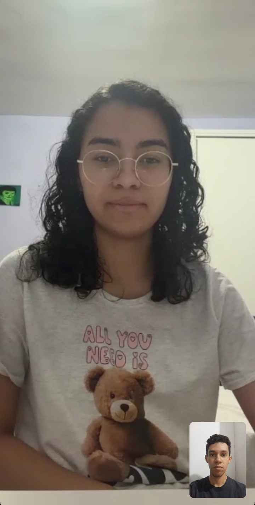

# 🎈 Mundo da Diversão — Site Institucional

Projeto acadêmico da disciplina de Desenvolvimento Frontend para Web (Entrega A2) — Prof. Cid Andrade.

## 👥 Integrantes do Grupo

| Nome completo | RGM | Usuário GitHub |
|---|---|---|
| Marcos André Aragão da Cunha | 48229776 | MarcosUkyo |
| Miguel Galego Meira | 47963662 | spiwskyn0-prog |
| Murilo Souza dos Santos | 48108987 | murilossantos |
| Nicolas Dias da Silva | 47609125 | nicolasdias1985 |
| Victor Hugo Gonzaga | 47300701 | VictorHugo1110 |

## 🌐 Site Publicado

- **Link do site hospedado:** [`https://marcosukyo.github.io/MundoDaDiversao/`](https://marcosukyo.github.io/MundoDaDiversao/)
- **Validação W3C (HTML):** todas as páginas validadas ([Nu Html Checker](https://validator.w3.org/nu/)):
  - [index.html](https://validator.w3.org/nu/?doc=https%3A%2F%2Fmarcosukyo.github.io%2FMundoDaDiversao%2Findex.html)
  - [quem-somos.html](https://validator.w3.org/nu/?doc=https%3A%2F%2Fmarcosukyo.github.io%2FMundoDaDiversao%2Fpages%2Fquem-somos.html)
  - [oficina.html](https://validator.w3.org/nu/?doc=https%3A%2F%2Fmarcosukyo.github.io%2FMundoDaDiversao%2Fpages%2Foficina.html)
  - [servicos.html](https://validator.w3.org/nu/?doc=https%3A%2F%2Fmarcosukyo.github.io%2FMundoDaDiversao%2Fpages%2Fservicos.html)
  - [galeria.html](https://validator.w3.org/nu/?doc=https%3A%2F%2Fmarcosukyo.github.io%2FMundoDaDiversao%2Fpages%2Fgaleria.html)
  - [feedback.html](https://validator.w3.org/nu/?doc=https%3A%2F%2Fmarcosukyo.github.io%2FMundoDaDiversao%2Fpages%2Ffeedback.html)
  - [faq.html](https://validator.w3.org/nu/?doc=https%3A%2F%2Fmarcosukyo.github.io%2FMundoDaDiversao%2Fpages%2Ffaq.html)
  - [pacotes.html](https://validator.w3.org/nu/?doc=https%3A%2F%2Fmarcosukyo.github.io%2FMundoDaDiversao%2Fpages%2Fpacotes.html)
  - [orcamento.html](https://validator.w3.org/nu/?doc=https%3A%2F%2Fmarcosukyo.github.io%2FMundoDaDiversao%2Fpages%2Forcamento.html)
  - [contato.html](https://validator.w3.org/nu/?doc=https%3A%2F%2Fmarcosukyo.github.io%2FMundoDaDiversao%2Fpages%2Fcontato.html)
  - [privacidade.html](https://validator.w3.org/nu/?doc=https%3A%2F%2Fmarcosukyo.github.io%2FMundoDaDiversao%2Fpages%2Fprivacidade.html)
  - [termos.html](https://validator.w3.org/nu/?doc=https%3A%2F%2Fmarcosukyo.github.io%2FMundoDaDiversao%2Fpages%2Ftermos.html)
- **Validação W3C (CSS):** [`assets/css/style.css`](https://jigsaw.w3.org/css-validator/validator?uri=https%3A%2F%2Fmarcosukyo.github.io%2FMundoDaDiversao%2Fassets%2Fcss%2Fstyle.css)

## 🏢 Introdução — A Organização

O **Mundo da Diversão** é uma empresa de recreação infantil para festas, fundada em 2025 em São Paulo por Victoria, biomédica, e sua mãe, pedagoga. A empresa nasceu da vontade de unir experiência com eventos e com educação infantil em um serviço de recreação de verdade: profissionais preparados, que enxergam cada criança de forma individual.

O Mundo da Diversão leva até a festa recreação infantil, pintura facial e oficinas criativas (como slime, miçanga e peteca), além da "baladinha com chuva de espuma", um diferencial incluído na recreação. A equipe é formada por recreadores freelancers selecionados com cuidado — nenhum profissional novo atua sozinho em um evento antes de ser acompanhado por alguém mais experiente. A empresa atende aniversários infantis, casamentos (espaço kids), colônias de férias e eventos corporativos/condominiais em São Paulo e região, sempre no local do cliente.

**Objetivo do site:** ser o local onde os pais e responsáveis conhecem o trabalho da empresa ao navegar na internet, entendendo as atividades oferecidas, os diferenciais, a missão e os valores. Os valores **não** são divulgados no site: todo orçamento é feito pelo WhatsApp, a pedido da cliente.

## 🎤 Contato com a Organização (comprovação da entrevista)

A entrevista foi realizada **presencialmente**, com Victoria, fundadora do Mundo da Diversão, no dia **25/08/2026, às 19h30**, seguindo o roteiro de levantamento de requisitos fornecido pelos professores (Modelagem de Dados e Desenvolvimento Frontend para Web).

Durante a conversa, Victoria contou a história da empresa (criada em 2025 a partir da união entre sua formação em biomedicina e a experiência da mãe como pedagoga), os serviços oferecidos (recreação infantil, pintura facial, oficinas e a baladinha com chuva de espuma), o processo de seleção e acompanhamento dos recreadores freelancers e os valores que guiam o trabalho, como a recreação inclusiva, sem nenhum tipo de segregação entre as crianças. Também definiu requisitos do site: cores e slogan iguais aos do Instagram e do site antigo, site de referência de design, nenhum valor exibido e orçamento sempre via WhatsApp.

**Forma de contato:** entrevista presencial.

**Comprovação:** o roteiro de entrevista preenchido com as respostas da Victoria durante a reunião está disponível para leitura no link abaixo:

- 📄 [Entrevista_Levantamento_Requisitos_Mundo-da-Diversão](https://acadcruzeirodosul-my.sharepoint.com/:w:/g/personal/marcos_cunha008_cs_cruzeirodosul_edu_br/IQB1h5tKD1zyRZ6T_7FYgdqyAb0CU4KNhOA4OEOBibnhdsM?e=ZcTexj)



## 🗂️ Estrutura do Projeto

```
/
├── index.html
├── README.md
├── assets/
│   ├── css/
│   │   └── style.css       # CSS único do projeto
│   ├── js/
│   │   ├── acessibilidade.js # comportamentos gerais (scroll suave, voltar ao topo)
│   │   ├── musica.js       # botão de música de fundo (<audio>)
│   │   ├── mascaras.js     # máscaras de telefone e CEP
│   │   └── forms.js        # contador de caracteres, rascunho e "lembrar meus dados"
│   ├── img/                # imagens, logo, ícones e SVGs
│   ├── audio/              # música de fundo
│   └── videos/             # vídeos (oficina e depoimento)
└── pages/
    ├── quem-somos.html
    ├── oficina.html
    ├── servicos.html
    ├── galeria.html
    ├── feedback.html
    ├── faq.html
    ├── pacotes.html
    ├── orcamento.html
    ├── contato.html
    ├── privacidade.html
    └── termos.html
```

## 🗺️ Mapa do Site

1. [`index.html`](https://marcosukyo.github.io/MundoDaDiversao/index.html) — Página inicial
2. [`pages/quem-somos.html`](https://marcosukyo.github.io/MundoDaDiversao/pages/quem-somos.html) — História, missão, valores e equipe
3. [`pages/oficina.html`](https://marcosukyo.github.io/MundoDaDiversao/pages/oficina.html) — Oficinas criativas (vídeo)
4. [`pages/servicos.html`](https://marcosukyo.github.io/MundoDaDiversao/pages/servicos.html) — Tipos de festa atendidos
5. [`pages/galeria.html`](https://marcosukyo.github.io/MundoDaDiversao/pages/galeria.html) — Galeria de fotos
6. [`pages/feedback.html`](https://marcosukyo.github.io/MundoDaDiversao/pages/feedback.html) — Depoimentos e formulário de feedback
7. [`pages/faq.html`](https://marcosukyo.github.io/MundoDaDiversao/pages/faq.html) — Perguntas frequentes e formulário de dúvidas
8. [`pages/pacotes.html`](https://marcosukyo.github.io/MundoDaDiversao/pages/pacotes.html) — Pacotes de festa
9. [`pages/orcamento.html`](https://marcosukyo.github.io/MundoDaDiversao/pages/orcamento.html) — Pedido de orçamento (formulário com máscaras e validação HTML5)
10. [`pages/contato.html`](https://marcosukyo.github.io/MundoDaDiversao/pages/contato.html) — Formulário de contato e outros canais
11. [`pages/privacidade.html`](https://marcosukyo.github.io/MundoDaDiversao/pages/privacidade.html) — Política de Privacidade
12. [`pages/termos.html`](https://marcosukyo.github.io/MundoDaDiversao/pages/termos.html) — Termos de Uso

## 🎨 Identidade Visual

Seguindo o pedido da cliente (cores e slogan do Instagram e do site antigo):

| Cor | Uso | HEX |
|---|---|---|
| Creme | Fundo principal | `#FFF6E5` |
| Tinta (ink) | Texto principal | `#2B2118` |
| Cinza-marrom | Texto secundário | `#7C7163` |
| Vermelho | Primária / CTA | `#E8453C` |
| Azul | Acento | `#2E6FF2` |
| Verde | Acento | `#2FA35D` |
| Amarelo | Acento | `#F4B400` |
| Escuro | Seções dark / rodapé | `#241C14` |

Tipografia: **Baloo 2** (títulos) e **Nunito** (texto corrido), via Google Fonts. Slogan: *"Diversão e aprendizado em cada brincadeira."*

## 🛠️ Desenvolvimento

- **Decisões de estrutura:** HTML semântico (`header`, `nav`, `main`, `section`, `article`, `footer`), um único `style.css` reutilizado nas 12 páginas, layout com Grid e Flexbox e menu de navegação igual em todas as páginas.
- **Conteúdo:** levantado na entrevista com a Victoria (serviços, diferenciais, missão e valores, horário, canais de contato). Fotos de crianças foram selecionadas com cuidado, pois a cliente pediu atenção à proteção de imagem.
- **Referência de layout:** site indicado pela cliente, <https://www.rcrecreacao.com.br/>.
- **Formulários:** contato, orçamento, feedback e dúvidas com validação nativa HTML5 (`required`, `pattern`, `minlength`, `type="email"`, `type="tel"`, `min`/`max`) e máscaras de telefone e CEP em JavaScript; os valores continuam sendo passados só pelo WhatsApp, a pedido da cliente.
- **JavaScript:** música de fundo com `<audio>` (`musica.js`), máscaras de digitação (`mascaras.js`) e recursos de formulário com `sessionStorage`/`localStorage` (`forms.js`).
- **Pesquisa de layout e testes de paleta/tipografia:** _(grupo: descrever aqui os sites pesquisados e as paletas/fontes testadas)_

## 🤖 Uso de IA

- **Modelo utilizado:** Claude (Anthropic).
- **Para que usamos:**
  - **Validação no W3C:** interpretar os erros e avisos do validador (HTML e CSS) e indicar como corrigi-los.
  - **Correção de código:** revisar HTML e CSS, achar links quebrados e inconsistências entre as páginas.
  - **Escolha da paleta de cores:** comparar combinações a partir das cores da logo e do Instagram da empresa, que a cliente pediu para manter.
  - **Encaixe das imagens:** ajustar tamanho, recorte e proporção das fotos (`object-fit`, molduras e grids) para ficarem bem distribuídas no site.
- **Motivação:** ganhar tempo em tarefas repetitivas e conseguir um site mais acessível e padronizado.
- **Verificação das respostas:** nenhuma sugestão foi aceita sem teste; o resultado foi conferido no W3C Validator e no CSS Validation Service e visualmente no navegador, em diferentes tamanhos de tela.

**Como seria obter o mesmo resultado com IA:** descrever o briefing completo (organização, páginas, paleta, restrições de semântica), pedir o código por etapas (mapa do site → HTML → CSS), revisar cada etapa e validar no W3C.

## ✅ Requisitos Técnicos da Entrega

- [x] Estrutura semântica (`header`, `nav`, `main`, `section`, `article`, `footer`)
- [x] Páginas HTML interligadas por menu consistente
- [x] Recurso de vídeo (`<video>` em `oficina.html` e `feedback.html`)
- [x] Recurso de áudio (`<audio>`)
- [x] Uso de SVG em uma das imagens
- [x] Resposta a eventos com JavaScript em ao menos um componente
- [x] Formulários com validação nativa HTML5
- [x] `contato.html` e `orcamento.html`
- [x] CSS único, responsivo, com Grid e Flexbox
- [x] Validação W3C (HTML e CSS) comprovada em todas as páginas

## 🧠 Conclusão e Aprendizados

Essa etapa exigiu bem mais cuidado do que parecia à primeira vista. Estruturar as páginas com semântica HTML correta trouxe decisões que não são óbvias no dia a dia — como escolher entre `section` e `article`, ou garantir um único `h1` por página com hierarquia de headings coerente, pontos que pesam na validação do W3C.

Organizar o repositório em `assets/` e `pages/` desde o início facilitou reaproveitar componentes (cards, "Como funciona", FAQ em accordion) sem duplicar CSS, já que todo o projeto usa um único `style.css`.

Trabalhar em equipe com Git e GitHub também foi parte importante do aprendizado: alinhar quem mexia em qual página, evitar conflitos de merge e manter um padrão de commits.

Por fim, basear o conteúdo na entrevista real com a Victoria deixou claro como as decisões de conteúdo (o que virou pacote, FAQ ou depoimento, e o que não pode aparecer, como valores) ficam mais sólidas quando partem de informação real da empresa.

---

*Projeto acadêmico — Desenvolvimento Frontend para Web.*
